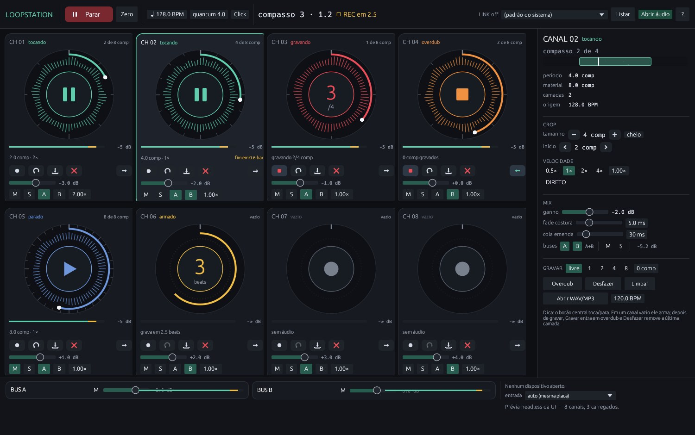

# Loopstation

**Alpha** — a live looping workstation for Windows, written in Rust.



Loopstation is a software looper built around a single musical clock. Eight loop channels,
quantized recording, overdub layers, non-destructive crop, speed changes that keep the pitch,
virtual buses and tempo sync over Ableton Link — all driven from circular pads that show the
waveform on the ring and the position like an analog clock.

> **Core principle:** there is exactly one musical clock — the audio engine's transport.
> The UI sends commands and reads snapshots; it never drives the playhead. Every musical
> decision happens on the beat/bar grid.

## Status: alpha, usable for early testing

| Milestone | Scope | Status |
|---|---|---|
| **M0 — Foundation** | workspace, tempo map, transport, click, offline engine, cpal I/O | done |
| **M1 — 8 channels** | quantized recording, overdub, undo, latency compensation | done |
| **M2 — Guide track** | WAV/MP3/FLAC/OGG decode, blocks and repeats | decode done, playback pending |
| **M3 — Crop/speed/buses** | crop, reverse, speed, gains, multi-bus routing | done |
| **M4 — Time-stretch** | real-time WSOLA with pitch preserved, seamless joint | done (offline re-render pending) |
| **M5 — MIDI + Link** | learn/pickup, Link session, master/follower policy | libraries done, app backend pending |
| **M6 — Project** | JSON + float32 WAV, save/open | format and I/O done, UI pending |

## Features

- **8 loop channels** with per-channel record, overdub, undo and clear.
- **Quantized recording**: the take starts on the next bar; with a fixed length (1, 2, 4, 8 or
  N bars) it closes by itself and the loop starts playing on the downbeat.
- **Countdown and progress**: the armed pad counts 4-3-2-1 in beats and, while recording, shows
  the bar being recorded (e.g. `2/4`) with an arc that fills — so you know exactly where the
  take starts and when it ends.
- **Latency compensation** (`comp`): the input delay is cut from the head of the take, and the
  recording runs `comp` longer so the last beat is never eaten. Optional acoustic calibration
  plays a click and measures the round trip.
- **Seam glue** (`cola emenda`): the extra reserve recorded after the material is crossfaded
  into the start of the loop, so the loop's end flows into its beginning without a jump.
- **Non-destructive crop**: crop 8 bars down to 2 and the material stays intact.
- **Speed 0.5x / 1x / 2x / 4x with pitch preserved** (WSOLA), locked to the grid while the
  tempo moves.
- **Per-channel gain, mute/solo, pan**, plus **multi-bus sends** (A, B or A+B in parallel).
- **Import WAV/MP3**: files that are not a whole number of bars are stretched to fit, so
  imported loops stay in sync with the recorded ones.
- **Input VU meter with trim**, automatic normalization of very quiet takes, and a diagnostics
  mode (`--diag`) that exercises input → take → playback.

## Requirements

- **Windows 10/11 x64** (WASAPI works out of the box; ASIO is optional).
- **Rust 1.82+** (edition 2021).

## Build and run

```bash
git clone https://github.com/<user>/loopstation.git
cd loopstation
cargo run -p looper-app --release
```

The GUI binary is `looper` (`default-run`), and there is a small CLI for diagnostics:

```bash
# list audio outputs and inputs
cargo run -p looper-app --bin looper-cli -- devices
cargo run -p looper-app --bin looper-cli -- inputs

# record two bars from the default input and report peaks + take envelope
./target/release/looper.exe --diag "Speakers (Realtek(R) Audio)" 0 12

# same, with the metronome on, to measure the acoustic round trip
./target/release/looper.exe --diag "Speakers (Realtek(R) Audio)" 0 12 --diag-click
```

## Audio backends

- **WASAPI** (default): output and input are separate devices; the input is opened at the output
  rate when the driver allows it, otherwise it is resampled (48 kHz in → 44.1 kHz out works).
  Some interfaces only allow one stream at a time in WASAPI shared mode — ASIO is the way out.
- **ASIO** (optional): requires the Steinberg ASIO SDK, which is **not redistributable**:

  ```bash
  set ASIO_SDK_DIR=C:\path\to\asiosdk
  cargo run -p looper-app --release --features asio
  ```

- The footer shows the host in use (`[Wasapi]`, `[Asio]`), so there is no doubt about the
  backend.

## Recording latency, in one paragraph

Whatever you play reaches the engine a few milliseconds to a few hundred milliseconds late
(driver buffer + output + air + input). Loopstation measures the input ring delay, adds it to
the take's cut, and lets you top it up with `comp` (0–1000 ms) — one beat at 120 BPM is 500 ms.
At the end of the take the first `comp` frames are discarded and the extra audio recorded past
the musical end is used as the **seam glue**: a crossfade that makes the loop's last frame flow
into its first. `calibrar` measures the round trip acoustically if you prefer not to guess.

## Tests

```bash
cargo test --workspace
cargo clippy --workspace --all-targets
cargo fmt --all -- --check
```

The suite is deterministic and offline: 22 test binaries covering tempo grid, recording,
overdub/undo, crop, speed, stretch quality, import quantization, buses, project I/O and the
UI view-model. No audio device is required.

## Repository layout

| Crate | Responsibility |
|---|---|
| `looper-core` | music primitives: tempo map, transport, crop, timing, settings, snapshots |
| `looper-stretch` | WSOLA time-stretch with pitch preserved, periodic loop window |
| `looper-decode` | WAV/MP3/FLAC/OGG decoding into float buffers |
| `looper-engine` | the real-time engine: channels, buses, click, commands, telemetry |
| `looper-audio` | cpal I/O, device probing, resampler |
| `looper-link` | Ableton Link session (tempo/beat sync) |
| `looper-midi` | MIDI mapping, learn and pickup |
| `looper-project` | project format (JSON + float32 WAV) |
| `looper-ui` | view-model and pure geometry helpers (no egui) |
| `looper-app` | egui/eframe UI, runtime bridge, CLI and diagnostics |

## Documentation

- [`docs/architecture.md`](docs/architecture.md) — design source of truth (in Portuguese).
- [`docs/adr/`](docs/adr/) — recorded decisions (speed semantics, seam fade, circular pads,
  real-time WSOLA).

## Contributing

Issues and pull requests are welcome. Please keep `cargo fmt`, `cargo clippy` and
`cargo test --workspace` clean, and add a test for any behaviour change in the engine.

## License

**GNU General Public License v3.0 or later** ([`LICENSE`](LICENSE)).

The license is GPL-3.0-or-later because the app links the **Ableton Link** library, which is
distributed under the GPLv3. If you need a different licensing arrangement, the Link integration
would have to be removed or replaced.

---

# Loopstation (Português)

**Alpha** — uma estação de looping ao vivo para Windows, escrita em Rust.

O Loopstation é um looper de software construído em torno de um único relógio musical. Oito
canais de loop, gravação quantizada, camadas de overdub, crop não destrutivo, mudança de
velocidade que preserva o pitch, buses virtuais e sincronismo de tempo via Ableton Link — tudo
operado por pads circulares que mostram a forma de onda no anel e a posição como um relógio
analógico.

> **Princípio central:** existe um único relógio musical — o transporte do motor de áudio.
> A UI envia comandos e lê snapshots; ela nunca manda no playhead. Toda decisão musical
> acontece na grade de beats/compassos.

## Estado: alpha, utilizável para testes iniciais

| Milestone | Escopo | Estado |
|---|---|---|
| **M0 — Fundação** | workspace, tempo map, transporte, click, motor offline, I/O cpal | concluído |
| **M1 — 8 canais** | gravação quantizada, overdub, undo, compensação de latência | concluído |
| **M2 — Trilha guia** | decode WAV/MP3/FLAC/OGG, blocos e repetições | decode pronto, playback pendente |
| **M3 — Crop/speed/buses** | crop, reverse, speed, ganhos, roteamento multi-bus | concluído |
| **M4 — Time-stretch** | WSOLA em tempo real com pitch preservado, emenda contínua | concluído (re-render offline pendente) |
| **M5 — MIDI + Link** | learn/pickup, sessão Link, política mestre/seguidor | bibliotecas prontas, backend no app pendente |
| **M6 — Projeto** | JSON + WAV float32, salvar/abrir | formato e I/O prontos, UI pendente |

## Recursos

- **8 canais de loop** com gravar, overdub, desfazer e limpar por canal.
- **Gravação quantizada**: a tomada começa no próximo compasso; com tamanho fixo (1, 2, 4, 8 ou
  N compassos) fecha sozinha e o loop já entra tocando na cabeça.
- **Contagem e progresso**: o pad armado conta 4-3-2-1 em beats e, durante a gravação, mostra o
  compasso corrente (ex.: `2/4`) com um arco que se enche.
- **Compensação de latência** (`comp`): o atraso da entrada é cortado do início da tomada e a
  gravação roda `comp` além do fim, para não comer o último tempo. Há calibração acústica
  opcional (toca um clique e mede a ida e volta).
- **Cola da emenda** (`cola emenda`): a reserva gravada depois do material entra no começo do
  loop com crossfade — o fim emenda no início sem salto.
- **Crop não destrutivo**: recorte de 8 para 2 compassos mantendo o material intacto.
- **Velocidade 0,5x / 1x / 2x / 4x com pitch preservado** (WSOLA), presa à grade.
- **Ganho, mute/solo e pan por canal**, com **envio para mais de um bus** (A, B ou A+B em
  paralelo).
- **Importação WAV/MP3**: arquivos que não têm um número inteiro de compassos são esticados
  para caber, mantendo a sincronia com os loops gravados.
- **VU de entrada com trim**, normalização automática de tomadas muito baixas e modo de
  diagnóstico (`--diag`) que exercita entrada → tomada → reprodução.

## Requisitos

- **Windows 10/11 x64** (WASAPI funciona de imediato; ASIO é opcional).
- **Rust 1.82+** (edição 2021).

## Compilar e rodar

```bash
git clone https://github.com/<usuario>/loopstation.git
cd loopstation
cargo run -p looper-app --release
```

O binário da interface é `looper` (`default-run`), e há uma CLI para diagnóstico:

```bash
# lista saídas e entradas de áudio
cargo run -p looper-app --bin looper-cli -- devices
cargo run -p looper-app --bin looper-cli -- inputs

# grava dois compassos da entrada padrão e mostra picos + envelope da tomada
./target/release/looper.exe --diag "Alto-falantes (Realtek(R) Audio)" 0 12

# idem, com metrônomo ligado, para medir a latência acústica de ida e volta
./target/release/looper.exe --diag "Alto-falantes (Realtek(R) Audio)" 0 12 --diag-click
```

## Backends de áudio

- **WASAPI** (padrão): saída e entrada são dispositivos separados; a entrada é aberta na taxa da
  saída quando o driver permite e, caso contrário, é reamostrada (48 kHz → 44,1 kHz funciona).
  Algumas interfaces só aceitam um stream por vez em WASAPI compartilhado — nesse caso o
  caminho é o ASIO.
- **ASIO** (opcional): exige o SDK da Steinberg, que **não é redistribuível**:

  ```bash
  set ASIO_SDK_DIR=C:\caminho\para\asiosdk
  cargo run -p looper-app --release --features asio
  ```

- O rodapé mostra o host em uso (`[Wasapi]`, `[Asio]`), para não haver dúvida do backend.

## Latência de gravação, em um parágrafo

O que você toca chega ao motor de alguns milissegundos a algumas centenas de milissegundos
depois (buffer do driver + saída + ar + entrada). O Loopstation mede o atraso do anel de entrada,
soma isso ao corte da tomada e deixa você completar com o `comp` (0–1000 ms) — um beat a 120 BPM
são 500 ms. No fim da tomada os primeiros `comp` frames são descartados e o áudio gravado além
do fim musical vira a **cola da emenda**: um crossfade que faz o último frame do loop desaguar
no primeiro. O botão `calibrar` mede a ida e volta de forma acústica, se você preferir não
chutar.

## Testes

```bash
cargo test --workspace
cargo clippy --workspace --all-targets
cargo fmt --all -- --check
```

A suíte é determinística e offline: 22 binários de teste cobrindo grade de tempo, gravação,
overdub/undo, crop, speed, qualidade do stretch, quantização de importação, buses, I/O de
projeto e o view-model da UI. Nenhum dispositivo de áudio é necessário.

## Estrutura do repositório

| Crate | Responsabilidade |
|---|---|
| `looper-core` | primitivas musicais: tempo map, transporte, crop, timing, ajustes, snapshots |
| `looper-stretch` | time-stretch WSOLA com pitch preservado, janela periódica de loop |
| `looper-decode` | decode de WAV/MP3/FLAC/OGG para buffers float |
| `looper-engine` | motor de tempo real: canais, buses, click, comandos, telemetria |
| `looper-audio` | I/O cpal, sondagem de dispositivos, reamostrador |
| `looper-link` | sessão Ableton Link (sincronismo de tempo/beat) |
| `looper-midi` | mapeamento MIDI, learn e pickup |
| `looper-project` | formato de projeto (JSON + WAV float32) |
| `looper-ui` | view-model e geometria pura (sem egui) |
| `looper-app` | UI egui/eframe, ponte com o runtime, CLI e diagnóstico |

## Documentação

- [`docs/architecture.md`](docs/architecture.md) — fonte de verdade do desenho (em português).
- [`docs/adr/`](docs/adr/) — decisões registradas (semântica do 2x, fade de costura, pads
  circulares, WSOLA em tempo real).

## Contribuindo

Issues e pull requests são bem-vindos. Mantenha `cargo fmt`, `cargo clippy` e
`cargo test --workspace` limpos e adicione um teste para qualquer mudança de comportamento do
motor.

## Licença

**GNU General Public License v3.0 ou posterior** ([`LICENSE`](LICENSE)).

A licença é GPL-3.0-or-later porque o app linka a biblioteca **Ableton Link**, distribuída sob
GPLv3. Se precisar de outro arranjo de licenciamento, a integração com o Link teria de ser
removida ou substituída.
